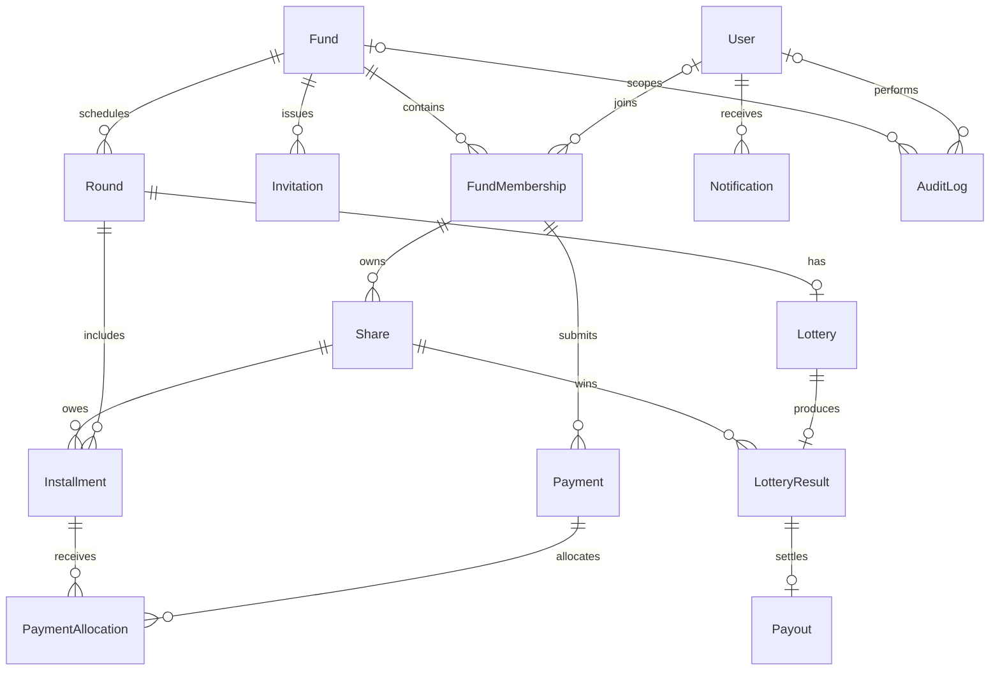

# Fundivo — Database Design

## 1. Overview

Fundivo uses PostgreSQL as its primary database.

This document defines the initial data model,
relationships, integrity constraints, and data policies.

Status: Draft v0.1 — subject to domain-level refinement.

No business domain migrations have been created yet.

## 2. Core Data Principles

- Public identifiers use UUIDs.
- Financial amounts are stored as integer Iranian rials (IRR).
- Floating-point types must not be used for money.
- Timestamps are timezone-aware and stored in UTC.
- All financial operations require transactional integrity.
- Financial corrections must preserve audit history.
- Access to fund data must be scoped by membership.
- Financial records must not be silently deleted.

## 3. Initial Entity Relationship Diagram

Relationships represent the initial conceptual model,
not finalized database foreign-key definitions.

## 4. Domain Entities

### User

Custom Django user model.

Responsible for identity, authentication,
and global account information.

Authentication will use verified mobile numbers.

### Fund

Represents a community savings or lending group.

Contains configuration, financial parameters,
scheduling rules, and lifecycle status.

### FundMembership

Connects a member to a fund.

Defines the member's fund-specific role and status.

A membership may temporarily exist without a
registered user account.

### Share

Represents one participation unit within a fund.

Each share belongs to a fund membership.

One membership may own multiple shares.

### Invitation

Represents an invitation to join a fund.

Invitations require expiration and secure validation.

### Round

Represents a scheduled payment and winner-selection
period within a fund.

### Installment

Represents the financial obligation of one share
during one round.

### Payment

Represents a recorded payment submitted by a member
or recorded by an authorized manager.

Payments require verification status and history.

### PaymentAllocation

Associates a payment with one or more installments.

Supports partial payments and multiple allocations.

### Lottery

Represents an execution of the winner-selection
process for a round.

### LotteryResult

Records the selected winning share and the
associated lottery execution.

### Payout

Represents the recorded settlement to a winner.

Winning and settlement are independent processes.

### Notification

Represents a user-facing notification and
its read status.

### AuditLog

Records sensitive business and administrative actions.

Includes actor, timestamp, target, and
required change information without secrets.

## 5. Planned Integrity Constraints

The following constraints must be considered
during model implementation:

- Unique registered user membership per fund.
- Unique round number within each fund.
- Unique installment for each share and round.
- No duplicate valid winner result per round.
- A share may win at most once per fund cycle.
- Financial amounts must satisfy domain-defined
  nonnegative or positive value constraints.
- Payment allocations must not exceed the
  amount available for allocation.
- Only verified payments affect installment balances.
- Cross-fund relationships must remain consistent.

Some invariants require service-level transactions,
locking, and additional database constraints.

## 6. Financial Data Rules

- Payments are recorded, not processed by Fundivo.
- Only approved payments affect financial balances.
- Corrections require traceable compensating records.
- Financial operations require idempotency protection.
- Lottery results must preserve execution history.
- Payout completion does not remove future obligations.

## 7. Deletion and History

Financial records should preserve historical integrity.

Deletion and modification policies must be finalized
for each domain before implementation.

Archiving is preferred over destructive deletion
for completed business records.

## 8. Open Design Decisions

The following details require further specification:

- Fund cycle boundaries and repeat participation.
- Guest membership identity and uniqueness.
- Share ownership transfer history.
- Payment correction and reversal model.
- Lottery retry and exceptional correction workflow.
- Receipt storage and access strategy.
- Payment eligibility and overdue policies.
- Payout verification process.

## 9. Implementation Status

This document is a preliminary conceptual design.

The actual Django models, migrations, foreign keys,
indexes, and database constraints will be implemented
incrementally during the corresponding development phases.

## Fund domain: implemented first migration

`funds.Fund` (UUID, name, description, status, creator, timestamps),
`funds.FundMembership` (UUID, fund FK, user FK, role, is_active, joined_at),
and `funds.AuditLog` (UUID, fund FK, actor FK, action, target_id, changed_fields, created_at).
Database constraints enforce unique `(fund,user)`, at most one active manager
per fund, allowed roles/states and a non-empty fund name. A manager is created
atomically with the fund. Guest membership and manager transfer are future work.
See [FUNDS.md](FUNDS.md).
