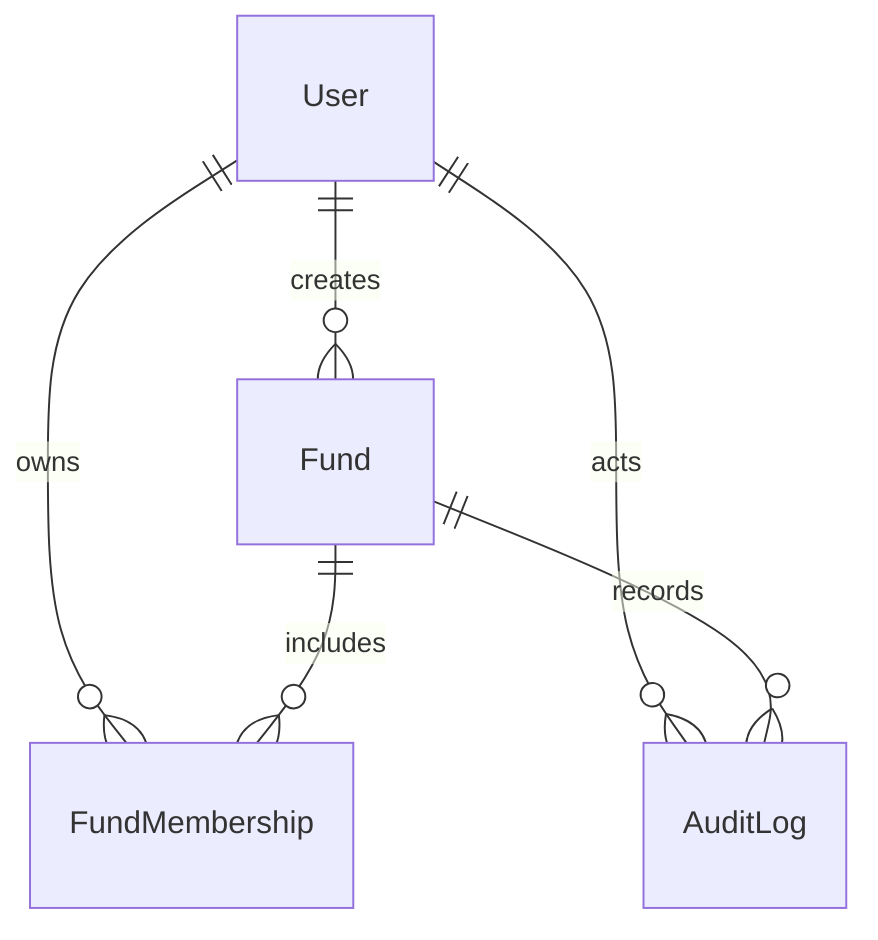

# Fundivo — Funds and Fund-Scoped Authorization (Phase 2, Package 1)

Status: initial implementation. Phase 2 is not complete.

## Scope of this package

Implemented:

- `Fund`: UUID, name, description, lifecycle status (initially `draft`), creator and timestamps.
- `FundMembership`: UUID, user, fund, `manager`/`member` role, active flag, joined timestamp.
- `AuditLog`: initial `fund.created` and `fund.updated` events containing actor and changed **field names**, never secret values.
- Transactional fund creation: a fund, its manager membership, and audit event are committed together.
- Authenticated fund list, create, detail, draft-edit and membership read endpoints.
- Fund-scoped queryset filtering, negative authorization tests, and database uniqueness constraints.
- Read-only Django Admin for the three domain tables.

**Not implemented**: temporary/guest memberships, manager transfer and acceptance, status activation, financial configuration, shares, rounds, archives, and comprehensive immutable audit storage. This is intentional: no person is made a fund member through an unconsented manager action. Those workflows belong to future packages.

## Domain model



`FundMembership.role` is a **per-fund** role; `User.is_staff` is only for platform-admin access.

In this first migration `FundMembership.user` is required. Supporting guest memberships will require an explicit, reviewed migration and identity policy in Phase 3.

## Integrity rules

- A user can have at most one membership in a given fund (database unique constraint).
- A fund can have at most one active manager (partial unique constraint).
- Every fund is initially created in the `draft` state.
- The service creates the fund and its manager atomically; an error rolls everything back.
- Client requests cannot set creator, status, role, or active flags.
- A manager can change only `name` and `description` while status is `draft`.
- No manager-removal or status-transition API is available yet, so the manager cannot be removed through these endpoints.
- There is no API for deleting funds, memberships or audit events.
- The event log is an initial application log, not an append-only/tamper-proof financial ledger; stronger audit protections are future work.

## HTTP contract

All endpoints require `Authorization: Bearer <access-token>` from the existing JWT flow.

| Method | Path | Who | Response |
| --- | --- | --- | --- |
| GET | `/api/v1/funds/` | Authenticated user | 200, paginated membership-scoped list |
| POST | `/api/v1/funds/` | Authenticated and verified user | 201, newly created draft fund |
| GET | `/api/v1/funds/{fund_id}/` | Active member | 200; 404 when not a member |
| PATCH | `/api/v1/funds/{fund_id}/` | Active manager only | 200; 403 if member; 409 if non-draft |
| GET | `/api/v1/funds/{fund_id}/membership/` | Active member | 200 own role; 404 if unrelated |
| GET | `/api/v1/funds/{fund_id}/memberships/` | Active manager only | 200 paginated list of membership IDs/UUIDs and roles |

`GET /api/v1/funds/` and the manager's memberships list return `{count, next, previous, results}` with up to 20 entries per page, maximum `page_size=100`.

**Create request**:

```json
{"name": "Family Savings Fund", "description": "Private group"}
```

**Response excerpt (201)**:

```json
{"id": "550e8400-e29b-41d4-a716-446655440000", "name": "Family Savings Fund", "description": "Private group", "status": "draft", "my_role": "manager"}
```

The actual response additionally includes `created_at` and `updated_at`. The example UUID is illustrative.

Only members can read fund details. `FundReadSerializer` does not return members' phone numbers. Only a manager can list member UUIDs; members can always read only **their own** membership via `/membership/`.

## Internal layering

- `models.py`: data shape and database constraints.
- `serializers.py`: public input/output contract and validation.
- `services.py`: transactions, authorization re-check and audit creation.
- `views.py`: HTTP handling and scoped querysets.
- `admin.py`: read-only internal inspection.
- `tests/test_funds.py`: positive, negative, rollback and uniqueness scenarios.

## Run the checks

After installing the bundle and creating `funds.0001_initial` locally:

```powershell
python backend\manage.py check
python backend\manage.py makemigrations funds
python backend\manage.py migrate --plan
python backend\manage.py migrate
python -m ruff check backend
python -m pytest -c backend/pytest.ini backend/tests -v
python backend\manage.py makemigrations --check --dry-run
python backend\manage.py spectacular --validate --fail-on-warn
```

Do not edit migration files after they have been applied without reviewing the impact.

## Invitation membership extension (Phase 3 — first slice)

Manager-created mobile-bound codes can now be accepted/rejected by a verified
recipient. The manager can list metadata or revoke a pending invitation. This
creates a regular member with consent and preserves fund scoping. See
[INVITATIONS.md](INVITATIONS.md). Guest memberships, shares, activation and
management transfer are not available yet.

## Planned share capacity now supported

Draft funds may set `target_share_count`; it cannot be reduced below the
number of allocated shares. See [SHARES.md](SHARES.md) for allocation and
visibility rules. Financial settings, activation and manager transfers remain
future work.

## Guest memberships

Draft funds may include registered members and non-login guest placeholders.
Only the active fund manager can create guests; existing manager-only membership
listing includes both types. See [GUEST_MEMBERSHIPS.md](GUEST_MEMBERSHIPS.md).

Draft fund managers may set the frozen-after-activation lottery eligibility policy. Implementation remains pending lottery and installment phases.
